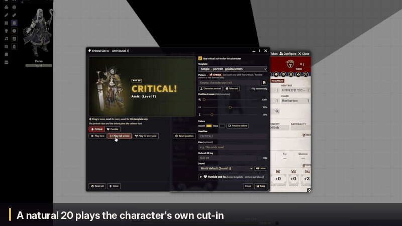
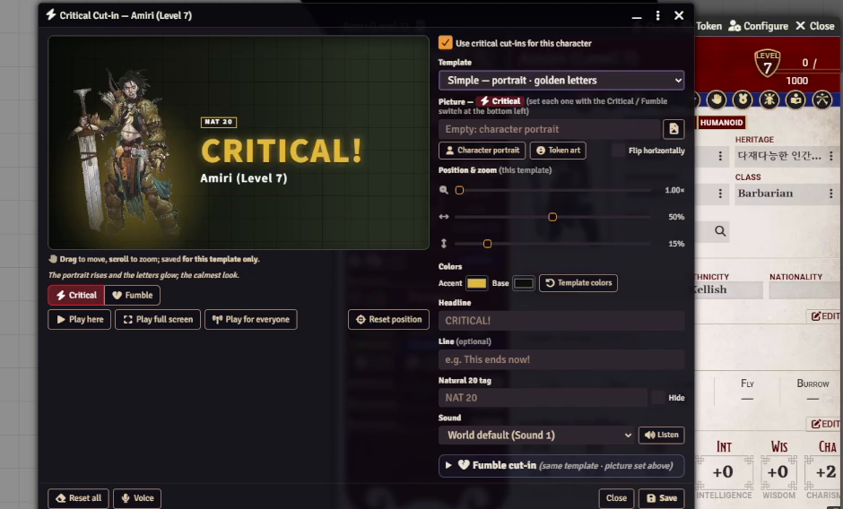
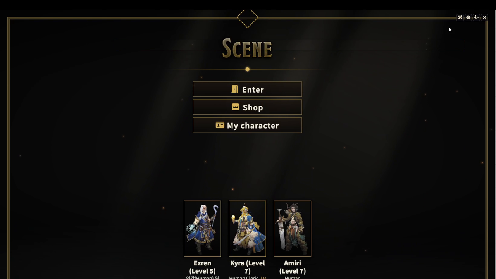

# Rutz's Cinematic Stage

[디스코드](https://discord.gg/bB7Ca666Bv) · [위키](https://github.com/Rutz179/rutz-crit-cutin/wiki/한국어-안내) · [English](README.md)

어떤 시스템에서든 쓰는 JRPG풍 연출입니다. 내추럴 20이나 치명적 성공이 나오면 그 캐릭터 그림으로 화면 가득 컷인이 뜨고, 캐릭터 대사와 월드의 타이틀 화면(랜딩 페이지)도 씁니다.

## 할 수 있는 것
- **치명타 컷인** — 내추럴 20·치명적 성공이 나오면 그 캐릭터 그림으로 컷인이 뜹니다. PF2e는 성공 등급, D&D 5e는 치명타 범위, CoC7은 01 대성공을 읽고, 다른 d20 시스템은 내추럴 20을 봅니다. Dice So Nice 주사위가 멈춘 뒤 재생합니다.
- **캐릭터별 편집** — 그림·위치·확대, 큰 글자, 대사, 내추럴 20 문구, 색, 효과음을 미리보기를 보며 정합니다. 효과음은 모듈이 직접 만들어서 소리 파일이 필요 없습니다.
- **캐릭터 보이스** — 공격·피해·쓰러짐·주문 때 나는 짧은 외침. 모듈에는 보이스 파일이 없습니다. 보이스 팩은 저작권이 있어 함께 배포할 수 없으니, 인터넷에서 쓸 수 있는 팩을 찾아 그 폴더를 고르세요.
- **랜딩 페이지** — 아무 장면이나 캠페인의 타이틀 화면으로.
- 다른 모듈 없이 혼자 동작합니다.



 

## 설치
Foundry → *Add-on Modules* → *Install Module* → Manifest URL:
```
https://github.com/Rutz179/rutz-crit-cutin/releases/latest/download/module.json
```
Foundry VTT v13–v14 · 모든 시스템 · 한국어 / English (Foundry 언어 설정을 따름)

## 빠른 시작
1. 모듈을 켭니다. 누군가 내추럴 20이나 치명적 성공을 굴리면 컷인이 알아서 뜹니다.
2. 캐릭터 시트 머리의 **컷인**으로 그 캐릭터만의 컷인을 꾸밉니다.
3. 설정: *설정 구성 → Rutz's Cinematic Stage*.

전체 안내: **[위키](https://github.com/Rutz179/rutz-crit-cutin/wiki/한국어-안내)** · 매크로: `game.rutzCutin.play(actor)`

질문·버그 제보: [Issues](https://github.com/Rutz179/rutz-crit-cutin/issues) 또는 [디스코드](https://discord.gg/bB7Ca666Bv).
