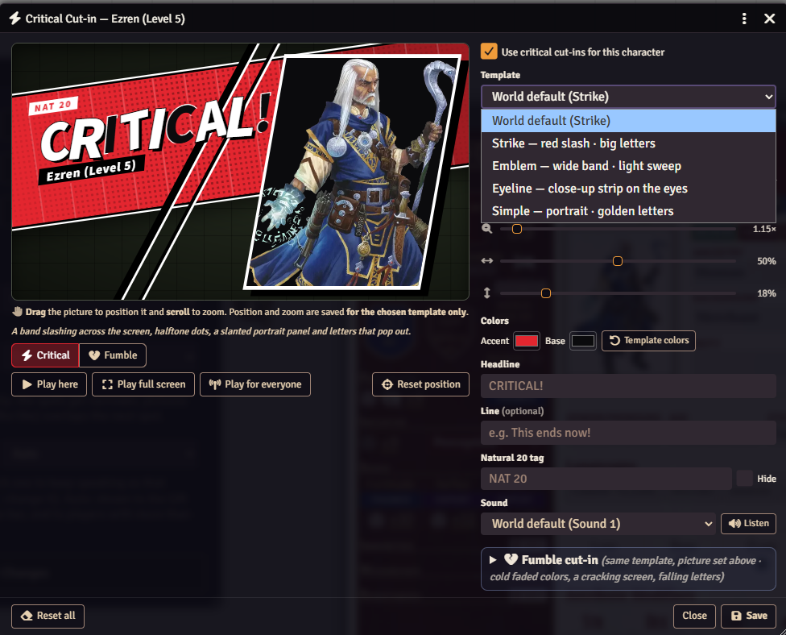

# Rutz's Cinematic Stage

[Patreon](https://www.patreon.com/Rutz179) · [Discord](https://discord.gg/bB7Ca666Bv) · [Wiki](https://github.com/Rutz179/rutz-crit-cutin/wiki) · [한국어](README.ko.md)

JRPG-style cut-ins for Foundry VTT, in any game system: a full-screen cut-in with the character's own picture on a natural 20 or a critical success, character voice lines, and a title screen for your campaign.

## Features
- **Critical cut-ins** — a natural 20 or critical success plays a cut-in with that character's picture. PF2e reads degrees of success, D&D 5e its crit range, CoC7 its 01 criticals; other d20 systems use the natural 20. Waits for Dice So Nice.
- **Per character** — picture, position and zoom, headline, quote, natural-20 tag, colors and sound, edited with a live preview. Built-in sounds, no audio files needed.
- **Landing page** — any scene becomes a title screen for your campaign.
- Works on its own — no other module needed.



## Install
Foundry → *Add-on Modules* → *Install Module* → Manifest URL:
```
https://github.com/Rutz179/rutz-crit-cutin/releases/latest/download/module.json
```
Foundry VTT v13–v14 · Any system · English / 한국어 (follows Foundry's language)

## Quick start
1. Enable the module. Cut-ins play on their own when someone rolls a natural 20 or a critical success.
2. Make one your own: **Cut-in** in a character sheet's header opens the editor.
3. Settings: *Configure Settings → Rutz's Cinematic Stage*.

Full guide: **[Wiki](https://github.com/Rutz179/rutz-crit-cutin/wiki)** · Macro: `game.rutzCutin.play(actor)`

Questions and bug reports: [Issues](https://github.com/Rutz179/rutz-crit-cutin/issues) or [Discord](https://discord.gg/bB7Ca666Bv).
