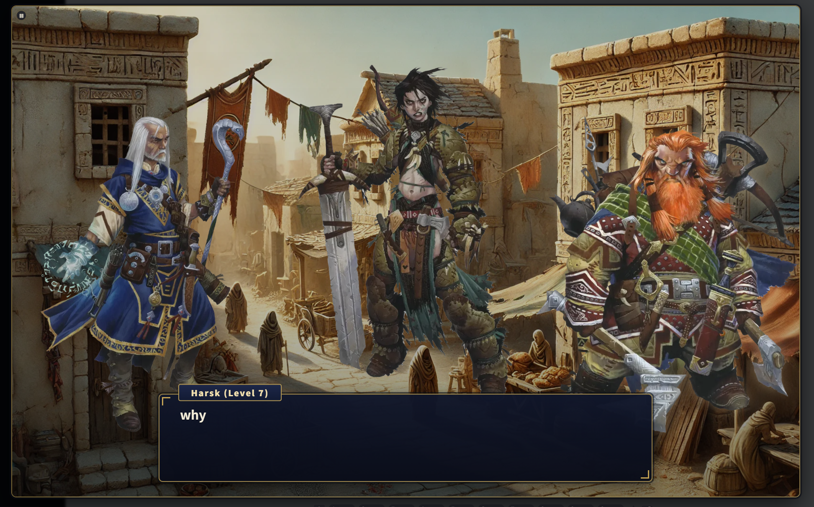
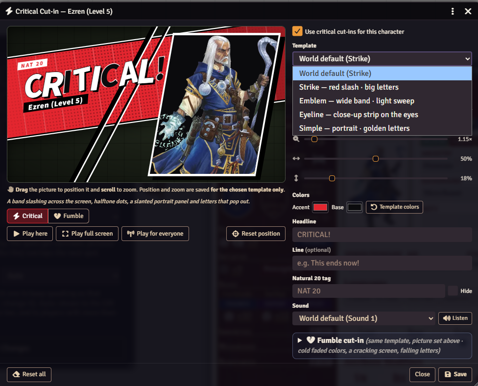
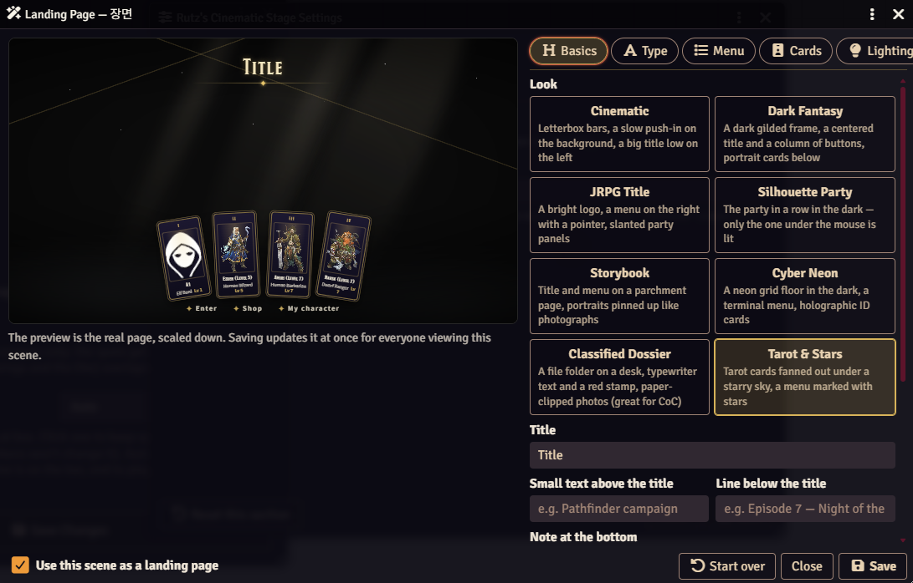

# Rutz's Cinematic Stage

Free Lite edition · [Plus on Patreon](https://www.patreon.com/Rutz179) · [Discord](https://discord.gg/pnVW5QmXKx) · [Wiki](https://github.com/Rutz179/rutz-crit-cutin/wiki) · [한국어](README.ko.md)

JRPG and visual-novel effects for Foundry VTT, in any game system: a full-screen cut-in with the character's own picture on a natural 20 or a critical success, and — in Plus — a serious-RP stage where whoever is talking walks on, plus a title screen for your world.



## Features
- **Critical & fumble cut-ins** — a natural 20 or critical success (and a natural 1 or critical failure) plays a cut-in with that character's picture. PF2e reads degrees of success; other d20 systems (D&D 5e …) use the natural 20 and 1. Waits for Dice So Nice.
- **Per character** — picture, position and zoom, headline, quote, natural-20 tag, colors and sound, edited with a live preview. Built-in sounds, no audio files needed.
- **Plus: four looks** — Strike, Emblem, Eyeline and Simple (Lite has Simple), and the fumble cut-in's own picture, words and sound.
- **Plus: serious-RP stage** — the GM turns it on; whoever types walks on stage, the one talking stands in front, quiet characters step back and leave. Dialogue box, expressions with `@keyword`, GM narration, backdrops, a speaker bar to choose who you speak as.
- **Plus: landing page** — any scene becomes a title screen with eight looks, a menu of buttons and the party's cards.
- Works on its own — no other module needed.

 

## Lite & Plus
This is the free edition. The **Plus** features above come with the Plus tier on [Patreon](https://www.patreon.com/Rutz179): join for a month, install from the [Rutz Module Hub](https://rutz-hub.rutz179.workers.dev), and keep it — it keeps working after you cancel. Rejoin any time for newer versions. Same module, so worlds keep their data. During the open beta every feature is free.

## Install
Foundry → *Add-on Modules* → *Install Module* → Manifest URL:
```
https://github.com/Rutz179/rutz-crit-cutin/releases/latest/download/module.json
```
Foundry VTT v13–v14 · Any system · English / 한국어 (follows Foundry's language)

## Quick start
1. Enable the module. Cut-ins play on their own when someone rolls a natural 20 or a critical success.
2. Make one your own: **Cut-in** in a character sheet's header opens the editor.
3. *(Plus)* The 🎭 button in the token controls (in the *Rutz Toolkit* tab with Rutz's PF2e HUD) opens the stage menu: **Turn on serious RP mode**, pick a backdrop, and start talking in chat.
4. Settings: *Configure Settings → Rutz's Cinematic Stage*.

Full guide: **[Wiki](https://github.com/Rutz179/rutz-crit-cutin/wiki)** · Macro: `game.rutzCutin.play(actor)`

Questions and bug reports: [Issues](https://github.com/Rutz179/rutz-crit-cutin/issues) or [Discord](https://discord.gg/pnVW5QmXKx).
